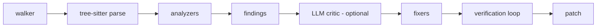

<h1 align="center">AST-Sieve</h1>

<p align="center">
  <a href="https://github.com/suryatejabatchu08/ast-sieve/actions">
    
  </a>
  
</p>

<p align="center">
An architecture-agnostic CLI agent that finds **security issues, AI slop, coding gaps and loose
ends** in any repository, then fixes the safe ones and **proves each fix before it ships**.
</p>



Design in one line: *deterministic analyzers find, an optional LLM can only refute, and no patch
ships unless it applies, re-parses, removes the finding and adds none.*

[Quickstart](#quickstart-offline-no-api-key) · [What it detects](#what-it-detects) · [Results](#results) · [Limitations](#known-limitations-honest-scope) · [Development](#development)

## Quickstart (offline, no API key)

```bash
pip install -e ".[dev]"
ast-sieve scan demo-messy-repo          # rich table of findings
ast-sieve scan demo-messy-repo --format sarif > results.sarif
ast-sieve fix demo-messy-repo           # dry run: prints the verified patch
cp -r demo-messy-repo ../demo-copy      # --apply edits files in place, so fix a copy
ast-sieve fix ../demo-copy --apply      # writes it
python scripts/evaluate.py              # precision / recall on the seeded benchmark
```

Everything above works with no network and no API key. Optional extras:

| Flag | What it adds |
|---|---|
| `--online` | Checks imports and manifest entries against PyPI and npm (catches hallucinated packages) |
| `--critic` | An OpenAI-compatible model reviews ambiguous findings and may drop false positives (`pip install -e ".[llm]"`, key in `AST_SIEVE_LLM_KEY`, optional `AST_SIEVE_LLM_BASE_URL`, `AST_SIEVE_LLM_MODEL`) |
| `--staged` | Report only files staged in git (pre-commit use) |
| `--exclude a,b` | Skip paths by glob |
| `--min-confidence 0.6` | Hide low-confidence findings (default 0.4) |
| `--fail-on high` | Exit code 1 threshold: `low`, `medium` (default), `high`, `never` |

Example with Groq:

```bash
AST_SIEVE_LLM_BASE_URL=https://api.groq.com/openai/v1 AST_SIEVE_LLM_MODEL=openai/gpt-oss-120b AST_SIEVE_LLM_KEY=... ast-sieve scan . --critic
```

## What it detects

| Rule | Finds | Languages |
|---|---|---|
| SEC001 | Hardcoded secrets (named assignments + entropy, known token shapes) | all |
| SEC002 | `verify=False`, `rejectUnauthorized: false`, `InsecureSkipVerify`, MD5/SHA1 | all |
| SEC003 | `eval`/`exec`, shell execution, unsafe deserialization, DOM sinks | all (AST for Python, patterns from `mapping.yaml` for the rest) |
| SEC004 | SQL built by concatenation / f-strings / format | all |
| TNT001 | Untrusted input reaching a dangerous sink (same function, plus one call hop) | Python |
| SLP001 | Renamed copy-pasted functions (normalized AST hash) | all |
| SLP002 | Unreachable code; functions unreachable in the call graph (entrypoint-aware) | all |
| SLP003 | Unused imports | Python |
| SLP004 | Commented-out code (the comment is parsed with the language's own grammar) | all |
| SLP005 | Stubs: `pass`, `...`, `NotImplementedError`, empty bodies, `validate_*` that returns `True` | all |
| SLP006 | TODO/FIXME/HACK/XXX density | all |
| GAP001 | Swallowed errors (`except: pass`, empty `catch`, empty `if err != nil`) | all |
| GAP002 | `requests`/`urlopen` calls without a timeout | Python |
| GAP003 | Tests with no (or only trivial) assertions, following assertion helpers | Python |
| DEP001/002 | Imports not in any manifest; with `--online`, packages that do not exist | Python, JS/TS |

Every finding carries file, lines, severity, confidence, evidence text and a stable message.
Findings in test files get lower security confidence. Suppress with
`# ast-sieve:ignore[RULE] reason`; a suppression without a reason is itself reported (SUP001).

## How "architecture agnostic" works

Language support is data, not code. Each language is a folder under
`ast_sieve/languages/` with a `mapping.yaml` that names the tree-sitter node types
(functions, classes, identifiers, blocks, terminal statements, comment prefix, entrypoints) and
language-specific line rules. Analyzers only read those mappings plus a language-neutral
helper layer in `parser.py`, so adding a language means adding a YAML file. Python, JavaScript,
TypeScript and Go ship today. There is no framework or layout assumption: a path or a single file
works, and monorepos and polyglot repos are scanned together.

## Results

**Seeded benchmark** (`demo-messy-repo/`, 35 planted issues across Python, JS and Go plus clean
control files and tricky look-alikes): precision 1.00, recall 1.00 offline, and the same with
`--online`. This benchmark was written alongside the analyzers, so it guards against regressions;
it is not an independent accuracy claim. See [BENCHMARK.md](BENCHMARK.md).

**Real code** (no labels, used to find false-positive classes, which were then fixed):

| Library | Files | LOC | Findings | Time |
|---|---|---|---|---|
| httpx | 23 | 8,828 | 17 | 1.1 s |
| typer | 34 | 13,418 | 29 | 1.6 s |
| rich | 100 | 38,515 | 29 | 4.2 s |
| pydantic | 106 | 46,895 | 104 | 6.1 s |
| networkx | 583 | 197,909 | 394 | 24.2 s |

**Verified fixes**: on the benchmark, 6 of 6 attempted patches passed the verification loop
([BEFORE_AFTER.md](BEFORE_AFTER.md)). Tests exercise the rejection paths too (broken syntax,
finding not removed, new finding introduced).

**Self-audit**: `ast-sieve scan . --exclude tests,demo-messy-repo` reports 0 findings at any
confidence on this repository, with no suppressions. See [SELF_AUDIT.md](SELF_AUDIT.md).

Step-by-step commands to see everything: [WALKTHROUGH.md](WALKTHROUGH.md).

## Known limitations (honest scope)

- **Taint is heuristic and Python-only**: assignment propagation within a function plus one
  call hop matched by function name. It is not real inter-procedural data-flow analysis.
- **Dead-code detection is name-based.** Public module-level functions that only external code
  calls are reported at low confidence (0.5); public methods are never reported.
- **Auto-fix and the verification loop cover Python only**, for: unused imports, dead code,
  commented-out code, `verify=False`, empty `except`. JS/TS/Go are scan-only.
- **JS/TS/Go depth is lower**: pattern rules, empty catch, stubs, dead code, duplicates,
  commented-out code. No taint, no unused-import detection, no Go dependency check.
- **GAP003 can flag intentional smoke tests** that only check that nothing raises.
- **The LLM critic is single-shot** (finding plus surrounding code in, verdict out). It is not a
  tool-using agent loop, it can only remove findings, and it fails open on any error. It was run
  once against `openai/gpt-oss-120b` on Groq (OpenAI-compatible endpoint) on the demo repo
  (dropped 0 of 35 findings); its accuracy has not been evaluated.
- Registry checks need network; results are cached per run. A benchmark package that does not
  exist today could be registered later, which would change the online benchmark result.

## Development

```bash
pip install -e ".[dev,llm]"
pytest                      # 58 tests
ruff check ast_sieve tests scripts
mypy ast_sieve
vulture ast_sieve --min-confidence 70
ast-sieve scan . --exclude tests,demo-messy-repo    # dogfood
docker build -t ast-sieve . && docker run --rm -v "$PWD:/code" ast-sieve scan /code
```

## Layout

```text
ast-sieve/
├── ast_sieve/
│   ├── cli.py
│   ├── engine.py
│   ├── parser.py
│   ├── walker.py
│   ├── callgraph.py
│   ├── patching.py
│   ├── report.py
│   ├── critic.py
│   ├── schemas.py
│   │
│   ├── analyzers/
│   │   ├── gaps.py
│   │   ├── slop.py
│   │   ├── unused.py
│   │   ├── security.py
│   │   ├── taint.py
│   │   └── phantom_deps.py
│   │
│   └── languages/
│       ├── python/
│       │   └── mapping.yaml
│       ├── javascript/
│       │   └── mapping.yaml
│       ├── typescript/
│       │   └── mapping.yaml
│       └── go/
│           └── mapping.yaml
│
├── demo-messy-repo/
│   ├── seeded benchmark
│   └── expected.json
│
├── scripts/
│   └── evaluate.py
│
├── tests/
├── docs/
├── AI_LOG.md
└── README.md
```

## AI usage

Built with Claude. Planning and review happened in a Claude chat, the initial scaffolding ran in
Claude Code, and the implementation was finished in a Claude chat session with code execution.
What was generated, what I corrected and why is recorded in [AI_LOG.md](AI_LOG.md).
